  <picture>
    <source media="(prefers-color-scheme: dark)" srcset="assets/hero-dark.svg">
    <source media="(prefers-color-scheme: light)" srcset="assets/hero-light.svg">
    
  </picture>

  <a href="https://github.com/AHL8192">
    <picture>
      <source media="(prefers-color-scheme: dark)" srcset="https://readme-typing-svg.demolab.com?font=Fira+Code&weight=500&size=21&pause=1300&color=7EE0FF&center=true&vCenter=true&width=720&lines=Programmer;Designer;Writer;YouTuber;Android+tinkerer;Making+old+hardware+feel+new">
      <source media="(prefers-color-scheme: light)" srcset="https://readme-typing-svg.demolab.com?font=Fira+Code&weight=500&size=21&pause=1300&color=1F8FC4&center=true&vCenter=true&width=720&lines=Programmer;Designer;Writer;YouTuber;Android+tinkerer;Making+old+hardware+feel+new">
      
    </picture>
  </a>

  <i>I build Android device trees, TypeScript dashboards, and design tooling — usually with too many tabs open.</i>

  <picture>
    <source media="(prefers-color-scheme: dark)" srcset="assets/rule-dark.svg">
    <source media="(prefers-color-scheme: light)" srcset="assets/rule-light.svg">
    
  </picture>

<table width="100%" align="center" border="0">
  <tr>
    <td width="33%" align="center" valign="top">
      <b>🛠 Building</b>  
      Android device trees, a TWRP build pipeline, and a news wall for the living room.
    </td>
    <td width="33%" align="center" valign="top">
      <b>✍️ Writing</b>  
      Notes on code, design, and the small details that make software feel alive.
    </td>
    <td width="33%" align="center" valign="top">
      <b>🎬 Filming</b>  
      Dev logs and experiments about the things I'm building.
    </td>
  </tr>
</table>

<!-- EDIT ME: the Writing and Filming lines are placeholders — tune them to your own voice. -->

  

  <picture>
    <source media="(prefers-color-scheme: dark)" srcset="assets/rule-dark.svg">
    <source media="(prefers-color-scheme: light)" srcset="assets/rule-light.svg">
    
  </picture>

<h3 align="center">Featured work</h3>

  <a href="https://github.com/AHL8192/news-tv-wall">
    <picture>
      <source media="(prefers-color-scheme: dark)" srcset="https://github-readme-stats.vercel.app/api/pin/?username=AHL8192&repo=news-tv-wall&bg_color=0d1117&title_color=7EE0FF&text_color=CFE9F5&icon_color=4CC2FF&border_color=1F3A52&hide_border=false&border_radius=12&description_lines_count=2">
      <source media="(prefers-color-scheme: light)" srcset="https://github-readme-stats.vercel.app/api/pin/?username=AHL8192&repo=news-tv-wall&bg_color=f5fbff&title_color=12526F&text_color=334E5C&icon_color=1F8FC4&border_color=D6E9F5&hide_border=false&border_radius=12&description_lines_count=2">
      
    </picture>
  </a>
  <a href="https://github.com/AHL8192/opencode-craft-skills">
    <picture>
      <source media="(prefers-color-scheme: dark)" srcset="https://github-readme-stats.vercel.app/api/pin/?username=AHL8192&repo=opencode-craft-skills&bg_color=0d1117&title_color=7EE0FF&text_color=CFE9F5&icon_color=4CC2FF&border_color=1F3A52&hide_border=false&border_radius=12&description_lines_count=2">
      <source media="(prefers-color-scheme: light)" srcset="https://github-readme-stats.vercel.app/api/pin/?username=AHL8192&repo=opencode-craft-skills&bg_color=f5fbff&title_color=12526F&text_color=334E5C&icon_color=1F8FC4&border_color=D6E9F5&hide_border=false&border_radius=12&description_lines_count=2">
      
    </picture>
  </a>
   
  <a href="https://github.com/AHL8192/gplus-q10-resources">
    <picture>
      <source media="(prefers-color-scheme: dark)" srcset="https://github-readme-stats.vercel.app/api/pin/?username=AHL8192&repo=gplus-q10-resources&bg_color=0d1117&title_color=7EE0FF&text_color=CFE9F5&icon_color=4CC2FF&border_color=1F3A52&hide_border=false&border_radius=12&description_lines_count=2">
      <source media="(prefers-color-scheme: light)" srcset="https://github-readme-stats.vercel.app/api/pin/?username=AHL8192&repo=gplus-q10-resources&bg_color=f5fbff&title_color=12526F&text_color=334E5C&icon_color=1F8FC4&border_color=D6E9F5&hide_border=false&border_radius=12&description_lines_count=2">
      
    </picture>
  </a>
  <a href="https://github.com/AHL8192/Auto-TWRP-Builder">
    <picture>
      <source media="(prefers-color-scheme: dark)" srcset="https://github-readme-stats.vercel.app/api/pin/?username=AHL8192&repo=Auto-TWRP-Builder&bg_color=0d1117&title_color=7EE0FF&text_color=CFE9F5&icon_color=4CC2FF&border_color=1F3A52&hide_border=false&border_radius=12&description_lines_count=2">
      <source media="(prefers-color-scheme: light)" srcset="https://github-readme-stats.vercel.app/api/pin/?username=AHL8192&repo=Auto-TWRP-Builder&bg_color=f5fbff&title_color=12526F&text_color=334E5C&icon_color=1F8FC4&border_color=D6E9F5&hide_border=false&border_radius=12&description_lines_count=2">
      
    </picture>
  </a>

  <picture>
    <source media="(prefers-color-scheme: dark)" srcset="assets/rule-dark.svg">
    <source media="(prefers-color-scheme: light)" srcset="assets/rule-light.svg">
    
  </picture>

<h3 align="center">The numbers</h3>

  <picture>
    <source media="(prefers-color-scheme: dark)" srcset="https://github-readme-stats.vercel.app/api?username=AHL8192&show_icons=true&include_all_commits=true&hide_border=false&border_color=1F3A52&rank_icon=github&bg_color=0d1117&title_color=7EE0FF&text_color=CFE9F5&icon_color=4CC2FF&border_radius=12">
    <source media="(prefers-color-scheme: light)" srcset="https://github-readme-stats.vercel.app/api?username=AHL8192&show_icons=true&include_all_commits=true&hide_border=false&border_color=D6E9F5&rank_icon=github&bg_color=f5fbff&title_color=12526F&text_color=334E5C&icon_color=1F8FC4&border_radius=12">
    
  </picture>
  <picture>
    <source media="(prefers-color-scheme: dark)" srcset="https://github-readme-stats.vercel.app/api/top-langs/?username=AHL8192&layout=compact&langs_count=4&hide_border=false&border_color=1F3A52&bg_color=0d1117&title_color=7EE0FF&text_color=CFE9F5&border_radius=12">
    <source media="(prefers-color-scheme: light)" srcset="https://github-readme-stats.vercel.app/api/top-langs/?username=AHL8192&layout=compact&langs_count=4&hide_border=false&border_color=D6E9F5&bg_color=f5fbff&title_color=12526F&text_color=334E5C&border_radius=12">
    
  </picture>

  <picture>
    <source media="(prefers-color-scheme: dark)" srcset="https://streak-stats.demolab.com?user=AHL8192&hide_border=false&border=1F3A52&background=0D1117&stroke=4CC2FF&ring=7EE0FF&fire=FFB86B&currStreakLabel=7EE0FF&sideLabels=CFE9F5&dates=8FB3C7&currStreakNum=E8F6FF&sideNums=E8F6FF&border_radius=12">
    <source media="(prefers-color-scheme: light)" srcset="https://streak-stats.demolab.com?user=AHL8192&hide_border=false&border=CFE6F4&background=F5FBFF&stroke=7ECBEF&ring=1F8FC4&fire=FF9A4D&currStreakLabel=12526F&sideLabels=334E5C&dates=6B8A9A&currStreakNum=071322&sideNums=071322&border_radius=12">
    
  </picture>

  <picture>
    <source media="(prefers-color-scheme: dark)" srcset="assets/rule-dark.svg">
    <source media="(prefers-color-scheme: light)" srcset="assets/rule-light.svg">
    
  </picture>

<h3 align="center">Elsewhere</h3>

  
  
  
  

  

  Designed &amp; built by <a href="https://github.com/AHL8192">AHL8192</a> · Aero Glass edition

